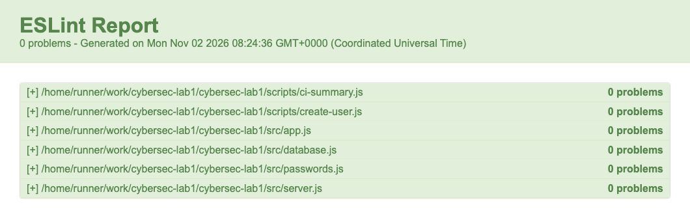
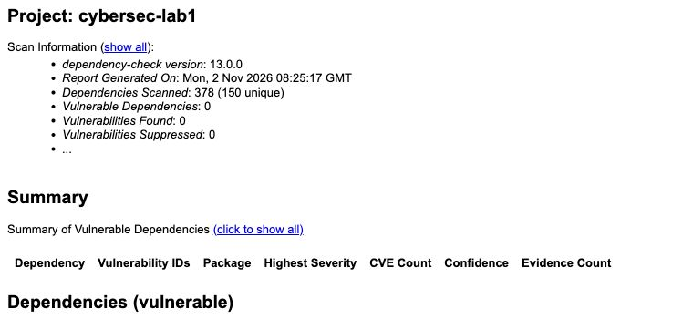

# Лабораторная работа 1: защищенный REST API и CI/CD

**Дисциплина:** Информационная безопасность, Университет ИТМО.  
**Автор:** Козлов Василий Сергеевич, P3415, 2026.

Учебный API личных заметок: Express, SQLite, JWT, scrypt. У каждого пользователя
свои записи. Создание пользователей выполняется локальной административной
командой; публичной регистрации и учетных записей с паролем по умолчанию нет.

Репозиторий: <https://github.com/Vaskozlov/cybersec-lab1>.  
Проверки: [GitHub Actions / Security CI](https://github.com/Vaskozlov/cybersec-lab1/actions/workflows/ci.yml).

## Запуск

Требуется Node.js 24 LTS, не ниже 24.13.0 (встроенный `node:sqlite`), и npm.
Используется зафиксированный `package-lock.json`.

```bash
git clone https://github.com/Vaskozlov/cybersec-lab1.git
cd cybersec-lab1
npm ci --ignore-scripts
export JWT_SECRET="$(openssl rand -base64 32)"
```

Создайте пользователя, введя пароль без сохранения в истории shell. В zsh:

```zsh
read -rs 'LAB_PASSWORD?Пароль (12-128 байт): '; echo
export LAB_PASSWORD
npm run create-user -- vasily
unset LAB_PASSWORD
npm start
```

Для bash замените `read` на `read -rs -p 'Пароль: ' LAB_PASSWORD; echo`.
Сервис слушает `http://127.0.0.1:3001`. По умолчанию БД - `lab1.db`.
`DB_PATH` и `PORT` можно изменить через окружение. `JWT_SECRET` - случайный ключ
в base64 длиной не менее 32 байт после декодирования; короткий или отсутствующий
ключ не позволит запустить сервер. Не добавляйте ключ, пароль или БД в git.

## API

| Метод | Маршрут | Доступ | Назначение |
| --- | --- | --- | --- |
| POST | `/auth/login` | Без JWT; 5 попыток/мин/IP | Выдать JWT по логину и паролю |
| GET | `/api/data` | Bearer JWT | Последние 100 собственных заметок |
| POST | `/api/data` | Bearer JWT | Создать собственную заметку; третий метод задания |

Тело запросов - JSON. Имя поля логина - `username`. Токен передается только в
`Authorization: Bearer <token>`, не в URL и не в cookie.
Некорректный JSON дает HTTP 400, превышение 16 KiB - 413,
неподдерживаемые charset и `Content-Encoding` - 415 с JSON-ошибкой.
Неожиданные ошибки дают 500 без внутренних подробностей.

### Проверка через curl

В отдельном терминале введите ранее созданный пароль:

```zsh
read -rs 'LAB_PASSWORD?Пароль: '; echo
export LAB_PASSWORD
LOGIN_JSON=$(node -e 'process.stdout.write(JSON.stringify({username:"vasily",password:process.env.LAB_PASSWORD}))')
LOGIN_RESPONSE=$(printf '%s' "$LOGIN_JSON" | curl -sS \
  -H 'Content-Type: application/json' --data-binary @- \
  http://127.0.0.1:3001/auth/login)
TOKEN=$(printf '%s' "$LOGIN_RESPONSE" | node -e \
  'let x="";for await(const p of process.stdin)x+=p;process.stdout.write(JSON.parse(x).access_token)' --input-type=module)
unset LAB_PASSWORD LOGIN_JSON LOGIN_RESPONSE
```

Успешный ответ: HTTP 200, `access_token`, `token_type: "Bearer"`,
`expires_in: 900`. Неверные учетные данные: HTTP 401 с одинаковой ошибкой для
несуществующего имени и неправильного пароля.

```bash
# Без токена: 401
curl -i http://127.0.0.1:3001/api/data

# Создание: 201
curl -i -H "Authorization: Bearer $TOKEN" \
  -H 'Content-Type: application/json' \
  -d '{"title":"Первая заметка","body":"Проверка API"}' \
  http://127.0.0.1:3001/api/data

# Чтение: 200, {"data":[...]}
curl -i -H "Authorization: Bearer $TOKEN" \
  http://127.0.0.1:3001/api/data

# SQLi: 401, таблица users сохраняется
curl -i -H 'Content-Type: application/json' \
  -d '{"username":"alice\u0027 OR 1=1 --","password":"incorrect"}' \
  http://127.0.0.1:3001/auth/login

# XSS: 201; тег вернется как &lt;script&gt;...&lt;/script&gt;
curl -i -H "Authorization: Bearer $TOKEN" \
  -H 'Content-Type: application/json' \
  -d '{"title":"XSS","body":"<script>alert(1)</script>"}' \
  http://127.0.0.1:3001/api/data
unset TOKEN
```

## Реализованные меры защиты

### SQL Injection

Все запросы с внешними данными используют `db.prepare()` и параметры `?`:

```js
db.prepare('SELECT account_id, password_hash FROM users WHERE username = ?').get(username);
db.prepare('INSERT INTO notes (owner_id, title, body) VALUES (?, ?, ?)')
  .run(userId, title, body);
```

SQL и значения передаются раздельно. Конкатенации пользовательских строк с SQL
нет. Имя и пароль проверяются по типу и размеру, но защита не зависит от поиска
опасных подстрок. Проверяются атака на вход и сохранение SQL-подобного текста
как обычной заметки.

### XSS и обработка ответов

Строки заметок экранируются функцией `escapeHtml` на выходе (`&`, `<`, `>`, `"`,
`'`). В БД хранится исходный текст, поэтому повторное чтение не добавляет второй
слой экранирования. Ответы имеют `Content-Type: application/json` и
`X-Content-Type-Options: nosniff`; Helmet устанавливает защитные HTTP-заголовки.
Пароль и его хэш никогда не попадают в ответы.

Это кодирование для HTML-текста, требуемое заданием. JSON сам по себе не является
HTML. Для отображения во frontend используйте `textContent`; не декодируйте
сущности с последующей вставкой в `innerHTML`. Экранирование не заменяет защиту
конкретного контекста JavaScript, URL или HTML-атрибута.

### Аутентификация и контроль доступа

- Пароли: `crypto.scrypt`, N=32768, r=8, p=3; соль 16 случайных байт, ключ 64 байта.
  В БД хранится только строка `scrypt$32768$8$3$<salt>$<hash>`.
  Сравнение ключей - `timingSafeEqual`.
- Для неизвестного пользователя выполняется scrypt с фиктивным хэшем.
  Ответы при неправильном пароле и неизвестном имени одинаковы.
- JWT подписывается библиотекой `jose`, только HS256. Middleware явно фиксирует
  алгоритм, проверяет подпись, `exp`, `iat`, `iss`, `aud`, `sub`, `jti`, тип JWT,
  максимальный возраст 15 минут и наличие пользователя в БД.
- `sub` содержит отдельный неизменяемый UUID `users.account_id`, создаваемый через
  `randomUUID()`. В БД он обязателен и уникален; триггер запрещает изменение.
  После проверки токена сервер находит этот аккаунт и получает его числовой
  `users.id` для работы с `notes.owner_id`. Повторное использование числового ID
  после удаления аккаунта не дает старому JWT доступ к новому аккаунту.
- В JWT нет пароля или чувствительных данных; подпись не шифрует содержимое.
- Middleware установлен на весь префикс `/api`. Владелец заметки определяется
  сервером через проверенный `sub`; переданный клиентом `owner_id` игнорируется.
  Чтение ограничено `WHERE owner_id = ?`.
- Вход: максимум 5 попыток в минуту с одного IP. `trust proxy` не включен,
  переданный клиентом `X-Forwarded-For` не позволяет сменить ключ ограничения.
- JSON ограничен 16 KiB; заголовок заметки - 1-120 символов, тело - до 2000.
  Ошибки не содержат SQL, stack trace или секретов. Ответы не кешируются.

При открытии старой БД выполняется автоматическая транзакционная миграция:
существующие аккаунты получают UUID, числовые ID, хэши паролей и заметки сохраняются.
При повторном открытии UUID не меняются. Ранее выданные токены с числовым `sub`
отклоняются с HTTP 401; после миграции необходимо войти заново.

Стенд рассчитан на один локальный процесс. Для публичного развертывания нужны
HTTPS и корректная конфигурация reverse proxy; распределенный rate limiter и
отзыв токенов выходят за рамки работы. При удалении пользователя его токены
теряют доступ; иначе выданный JWT действует до истечения срока.

## CI/CD и аудит

Файл [`.github/workflows/ci.yml`](.github/workflows/ci.yml) запускается на каждом
`push`, `pull_request` и вручную. Deployment задание не требует: реализована
часть CI с обязательными проверками безопасности.

1. **API tests and SAST:** `npm ci --ignore-scripts`, `npm test`,
   `npm run sast` (ESLint + eslint-plugin-security). Любая ошибка или
   предупреждение анализатора завершает job неуспешно. Для shell явно задан
   `bash` с `pipefail`, поэтому запись через `tee` не скрывает провал `npm test`.
   Скрипт CI summary независимо проверяет итоговый лог: ненулевое число тестов,
   прохождение всех и отсутствие провалов, отмен, пропусков и todo.
2. **SCA:** `npm audit --audit-level=high --json`, затем OWASP Dependency-Check
   13.0.0 сканирует `package.json` и `package-lock.json`, включая dev-зависимости.
   Применяется `--failOnCVSS 7`; ошибка сканера/загрузки также завершает job.
3. HTML/JSON-отчеты и результаты тестов сохраняются в Actions artifacts;
   фактические итоги вынесены в Job summary. Версии Actions закреплены SHA,
   архив Dependency-Check проверяется SHA-256, workflow имеет `contents: read`.

SAST анализирует исходный код. npm audit и Dependency-Check относятся к SCA:
сопоставляют версии зависимостей с уведомлениями об уязвимостях. Успешный аудит
не является доказательством отсутствия любых ошибок в приложении.

Для запуска Dependency-Check **токены не нужны**. NVD загружается из официальных
публичных JSON 2.0 feeds, база кешируется между запусками. Node Audit Analyzer
также использует npm advisory service. Sonatype OSS Index отключен, поскольку
требует отдельной авторизации; NVD и npm-анализаторы включены.

В ходе первоначального аудита обнаружен `minimatch <11.0.1` в дереве ESLint
([GHSA-g3hv-75wg-m249](https://github.com/advisories/GHSA-g3hv-75wg-m249)).
В `package.json` закреплен `overrides.minimatch=11.0.1`, lockfile обновлен.
Это исправление dev-зависимости, а не исключение результатов из сканирования.
Оригинальный npm-audit до исправления на пять moderate-записей не был сохранен.
Эта цифра описывает первоначальный локальный опыт 01.11.2026; приложенные
отчеты подтверждают только состояние после обновления.

### Предупреждения и их проверка

В [первом запуске](https://github.com/Vaskozlov/cybersec-lab1/actions/runs/41307390532)
присутствовали реальные предупреждения об устаревшем Node 20 runtime самих
GitHub Actions и вызовах `punycode`/`url.parse()` внутри старых Actions.
Они не были находками SAST/SCA в приложении. Причина устранена обновлением
проверенных SHA: checkout 7.0.1, setup-node 7.1.0, upload-artifact 7.0.2,
cache 6.1.0; все четыре Actions объявляют `runs.using: node24`.
Проверенный запуск после исправлений от 02.11.2026: [Security CI #5](https://github.com/Vaskozlov/cybersec-lab1/actions/runs/41412819229).
Оба job завершились успешно; в их журналах нет предупреждений, сообщений
deprecation и notices. Пройдены 24 теста (19 API и 5 CI-регрессий), 12 curl-проверок;
ESLint проверил 6 файлов без ошибок и предупреждений; npm audit и Dependency-Check
не нашли известных уязвимостей в 150 уникальных зависимостях.
Числа сверены с оригинальными отчетами и `output/evidence/ci-result.json`.
Оригинальные отчеты приложены в `output/evidence/`.

Сообщение `git init` о выборе имени начальной ветки - информационная подсказка
Git. Checkout сразу переключает репозиторий на `main`; это не уязвимость,
не ошибка проверки и не предупреждение GitHub Actions.
Уведомление уровня `notice` о миграции `ubuntu-latest` на Ubuntu 26 относится
к инфраструктуре GitHub, а не к уязвимости проекта. Для воспроизводимости
окружение закреплено как `ubuntu-24.04` - тот же образ, на котором прошли проверки.
Начальное имя ветки Git в одноразовом runner явно установлено в `main`.

В `scripts/ci-summary.js` есть одно точечное исключение правила
`security/detect-non-literal-fs-filename`: путь к summary берется из переменной
`GITHUB_STEP_SUMMARY`, которую создает GitHub runner. Этот скрипт выполняется
только в CI; HTTP-клиент API не управляет ни путем, ни окружением runner.
Таким образом, предполагаемый анализатором путь от внешнего ввода к записи
произвольного файла здесь отсутствует. Остальные security-правила включены,
`--max-warnings 0` остается обязательным.

Локальные проверки:

```bash
npm test
npm run sast
npm audit --audit-level=high
```

Регрессионные тесты проверяют отказ старому JWT после удаления аккаунта и
повторного использования числового ID, миграцию старой БД с сохранением заметок,
стабильность UUID при повторном открытии и ответы HTTP 415. Отрицательная проверка
pipeline намеренно завершает команду до `tee` с ошибкой и проверяет, что следующий
этап не исполняется. Результаты входят в общий вывод `npm test`.

## Материалы выполнения

- [Отчет в PDF](output/pdf/otchet_lab1_secure_api_kozlov.pdf), оформленный по образцу лабораторной работы 2.
- [Полный протокол curl](output/evidence/http-transcript.txt) и
  [структурированные результаты](output/evidence/http-results.json).
- Оригинальные HTML-отчеты [ESLint](output/evidence/eslint.html) и
  [Dependency-Check](output/evidence/dependency-check-report.html) получены из artifacts Actions;
  их снимки сделаны во встроенном браузере. Снимок общего результата показывает страницу Actions.
- [Разбор происхождения доказательств](output/evidence/README.md).
- Исходник PDF: `report.typ`; сборка: `typst compile report.typ output/pdf/otchet_lab1_secure_api_kozlov.pdf`.
- Сборка с предварительной проверкой доказательств: `python3 scripts/build_report.py`.
  Сборщик отдельно сверяет итоговый лог тестов и поля `tests_*` сводки,
  исходные метаданные CI, отчеты сканеров, охват lockfile и журналы.
  Для пересборки нужны Typst и шрифты Times New Roman и DejaVu Sans Mono.
- Для повторного получения HTTP-доказательств: `python3 scripts/capture_http.py`
  (нужны Node.js, Python 3, curl и свободный локальный порт 3001).





## Контрольные вопросы

**1. Почему bcrypt/scrypt предпочтительнее SHA-256 для паролей?**
SHA-256 специально рассчитан на быструю обработку и позволяет быстро перебирать
кандидаты, особенно на GPU. Парольные KDF используют соль и регулируемую стоимость;
scrypt дополнительно требует память. Соль препятствует использованию заранее
вычисленных таблиц и одинаковым хэшам одинаковых паролей разных пользователей.

**2. Чем SAST отличается от DAST?**
SAST исследует код без запуска сервиса и находит потенциально опасные конструкции.
DAST обращается к работающему приложению извне и проверяет наблюдаемое поведение.
В этой работе ESLint выполняет SAST, HTTP-тесты проверяют поведение API,
а Dependency-Check и npm audit выполняют отдельный вид анализа - SCA.

**3. Как работает JWT?**
Токен JWS состоит из заголовка, payload и подписи в base64url. Сервер проверяет
подпись известным ключом, фиксированный алгоритм и claims. В HS256 используется
общий секрет; любой обладатель ключа способен выпускать токены. Payload читается
без ключа, поэтому пароль в него помещать нельзя. Здесь `sub` - UUID `account_id`,
`iss`/`aud` - сервис и клиент, `iat`/`exp` - время выдачи/истечения, `jti` - ID токена.

**4. Чем опасен отказ от аудита сторонних библиотек?**
Уязвимость может находиться в прямой или транзитивной зависимости, включая
инструменты CI. Без SCA обновления и известные CVE легко пропустить; последствия
включают обход доступа, утечки и отказ в обслуживании. Lockfile обеспечивает
воспроизводимость, но требует повторного сканирования и своевременных обновлений.

## Источники

- [OWASP: SQL Injection Prevention](https://cheatsheetseries.owasp.org/cheatsheets/SQL_Injection_Prevention_Cheat_Sheet.html).
- [OWASP: Password Storage](https://cheatsheetseries.owasp.org/cheatsheets/Password_Storage_Cheat_Sheet.html).
- [OWASP: Cross Site Scripting Prevention](https://cheatsheetseries.owasp.org/cheatsheets/Cross_Site_Scripting_Prevention_Cheat_Sheet.html).
- [Node.js: SQLite](https://nodejs.org/docs/latest-v24.x/api/sqlite.html).
- [jose: JWT verification](https://github.com/panva/jose).
- [Dependency-Check: CLI](https://dependency-check.github.io/DependencyCheck/dependency-check-cli/arguments.html).
- [Dependency-Check: NVD feeds](https://dependency-check.github.io/DependencyCheck/data/mirrornvd.html).
- [GitHub Actions: workflow syntax](https://docs.github.com/en/actions/reference/workflows-and-actions/workflow-syntax).
